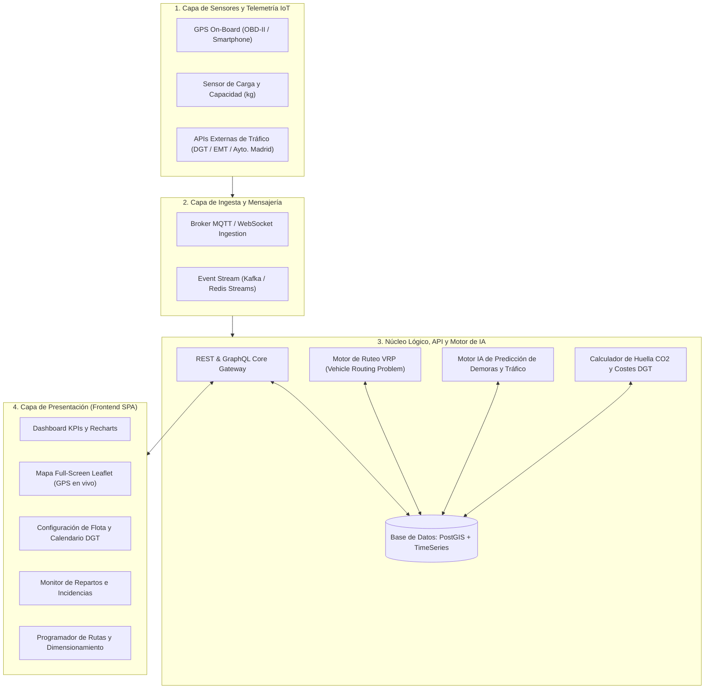
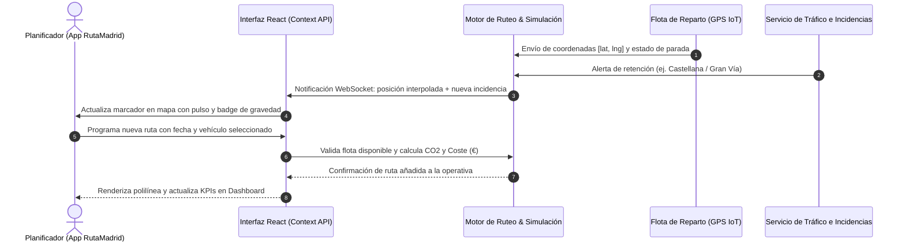

# Documento de Definición, Arquitectura y Prototipo: RutaMadrid

---

## 1. Definición del Problema y Contexto Urbano

### 1.1. Perfil del Usuario Objetivo
El usuario objetivo de la plataforma **RutaMadrid** es el **Gestor o Planificador de Entregas Urbanas** (*Fleet & Dispatch Manager / Traffic Coordinator*):

- **Rol y Responsabilidades**:
  - Supervisar flotas heterogéneas de reparto (furgonetas eléctricas, vehículos térmicos, ciclomotores y bicicletas de carga).
  - Asignar rutas y paquetes a conductores en función de la capacidad volumétrica y de peso.
  - Asegurar el cumplimiento de los tiempos de entrega (SLA) comprometidos con clientes y comercios.
  - Minimizar costes operativos (combustible, recargas eléctricas, mantenimiento y desgaste).
  - Cumplir rigurosamente las normativas medioambientales municipales y evitar sanciones de tráfico.
- **Puntos de Dolor (*Pain Points*)**:
  - Falta de visibilidad en tiempo real de la ubicación exacta de los vehículos y del avance de paradas.
  - Restricciones crecientes de acceso a áreas urbanas protegidas según el distintivo ambiental de la DGT.
  - Incidencias imprevisibles en la vía pública (atascos repentinos, calles cortadas por obras, zonas de carga y descarga saturadas).
  - Dificultad para calcular el impacto medioambiental (huella de carbono CO₂) y justificar informes de sostenibilidad corporativa ESG.

---

### 1.2. El Contexto Urbano: Madrid y su Movilidad
Madrid presenta uno de los ecosistemas logísticos urbanos más exigentes y regulados del sur de Europa:

- **Zonas de Bajas Emisiones (ZBE)**:
  - **ZBEDEP Distrito Centro** (antiguo Madrid Central): Acceso restringido exclusivamente a vehículos con etiqueta **0 Emisiones** y **ECO**. Los vehículos con distintivo **C** y **B** solo pueden entrar si acceden directamente a un aparcamiento público o cuentan con autorizaciones específicas de carga y descarga en franjas horarias muy reducidas.
  - **ZBEDEP Plaza Elíptica**: Área con restricciones reforzadas en el sur de la capital.
  - **Madrid ZBE Exterior (interior de la M-30 y perímetro municipal)**: Prohibición progresiva de circulación a vehículos sin distintivo ambiental (etiqueta A / sin etiqueta).
- **Morfología y Tráfico Urbano**:
  - La almendra central cuenta con calles estrechas y semipeatonales (Malasaña, La Latina, Lavapiés) donde furgonetas convencionales generan cuellos de botella y sufren maniobras complejas.
  - Grandes arterias de alta densidad (Paseo de la Castellana, Gran Vía, Calle de Alcalá, M-30) con alta probabilidad de atascos e incidencias por obras o manifestaciones.
- **Distribución Urbana de Mercancías (DUM)**: Plazas de carga y descarga limitadas temporalmente, a menudo ocupadas indebidamente por turismos particulares.

---

### 1.3. Caso de Uso Concreto: Jornada Operativa Crítica
> **Escenario**: Mañana de reparto con 84 entregas prioritarias programadas desde el Hub Central de Abroñigal (Méndez Álvaro) hacia los distritos Centro, Chamartín, Ciudad Lineal y Usera.
>
> 1. **08:30**: El planificador abre la plataforma, consulta la disponibilidad de flota (7 de 8 vehículos activos, uno en taller) y comprueba las restricciones ZBE para asignar las zonas peatonales de Sol y Gran Vía a la *Bicicleta de carga* (0 Emisiones).
> 2. **10:15**: Ocurre una incidencia grave de tráfico: *Obras de asfaltado de emergencia provocan retención severa en Paseo de la Castellana con Raimundo Fernández Villaverde*.
> 3. **10:16**: La plataforma alerta visualmente al planificador, mostrando la ruta Norte-Chamartín afectada y permitiendo al gestor reprogramar paradas o advertir al destinatario de Torre Picasso.
> 4. **12:00**: El gestor programa un nuevo refuerzo de ruta vespertino para Casa de Campo evaluando al instante el balance entre emisiones de CO₂ y coste operativo en función del vehículo que asigna.

---

## 2. La Solución: Plataforma RutaMadrid

### 2.1. Propósito y Valor Diferencial
**RutaMadrid** es una suite web inteligente de gestión y despacho logístico urbano que integra en una sola interfaz reactiva:
- Seguimiento cartográfico GPS en tiempo real con OpenStreetMap.
- Gestión de flota con control de distintivos ambientales de la DGT.
- Calendario interactivo de disponibilidad diaria por vehículo.
- Monitorización activa de incidencias viales.
- Motor de cálculo y dimensionamiento ecológico de rutas (estimación de CO₂ y coste en €).

---

### 2.2. Arquitectura Integral del Sistema (App + API + Sensores IoT + IA)



#### Descripción de cada bloque:
1. **Capa de Sensores e IoT**:
   - Dispositivos telemáticos en vehículos o terminales móviles de los repartidores que envían coordenadas geográficas, velocidad y peso transportado.
   - Conectores con el portal de datos abiertos del Ayuntamiento de Madrid y cámaras de tráfico de la M-30.
2. **Capa de Ingesta y Mensajería**:
   - Normaliza paquetes telemáticos a alta frecuencia mediante WebSockets/MQTT para emitir las actualizaciones de posición cada pocos segundos.
3. **Núcleo de Servicios, API y Motor de IA**:
   - **Motor VRP (Vehicle Routing Problem)**: Optimiza el orden de paradas para minimizar kilómetros y tiempo en atascos.
   - **Motor de IA Predictivo**: Analiza patrones históricos de tráfico en Madrid (horas punta en M-30, accesos a colegios o carga en Gran Vía) para anticipar demoras.
   - **Calculador Eco-Cost**: Asigna factores de emisión según pegatina DGT (0 g CO₂ para eléctricos, factores escalonados para ECO, C y B) y calcula el coste unitario por kilómetro recorrido.
   - **Base de Datos Geoespacial (PostGIS)**: Almacena polilíneas de calles, paradas, ubicaciones de hubs y estados históricos.
4. **Capa de Presentación (Frontend React + Leaflet)**:
   - Aplicación web responsive, con navegación por Drawer lateral, renderizado vectorial y estado global reactivo.

---

### 2.3. Flujo de Datos (*Data Flow*)



---

## 3. El Prototipo de la Aplicación

### 3.1. Sistema de Diseño (UI/UX y Tokens)
- **Filosofía**: *Clean & Operational Dashboard*, inspirado en centros de control de tráfico y herramientas logísticas de última milla.
- **Enfoque**: *Mobile-First*, optimizado tanto para teléfonos y tablets de campo como para pantallas de monitorización de oficina.
- **Paleta de Colores**:
  - *Color de marca*: Azul Eléctrico (`#2563eb`) e Índigo (`#4f46e5`).
  - *Sostenibilidad / Éxito*: Verde Esmeralda (`#10b981`) para vehículos 0 Emisiones y entregas completadas.
  - *Alertas*: Ámbar (`#f59e0b`) para incidencias medias y Rosa/Rojo (`#e11d48`) para incidencias de gravedad alta.
  - *Badges oficiales DGT*: Azul (0 Emisiones), Verde/Azul (ECO), Verde (C), Amarillo (B), Gris (Sin distintivo).
  - *Soporte Oscuro/Claro*: Basado en el esquema de color del sistema (`prefers-color-scheme`).

---

### 3.2. Estructura Navegable
- **Cabecera Fija**:
  - Botón de menú hamburguesa a la izquierda.
  - Logotipo e insignia "RutaMadrid - MAD".
  - Contador rápido de incidencias activas con animación de alerta.
  - Interruptor interactivo de simulación (*Pausar / En vivo*).
- **Menú Lateral Desplegable (Drawer)**:
  - Fondo oscurecido con desenfoque (`backdrop-blur`).
  - 5 opciones de navegación con enlace activo resaltado:
    1. Inicio
    2. Mapa Madrid
    3. Configuración vehículos
    4. Repartos
    5. Programar rutas

---

### 3.3. Especificación de Pantallas Principales

```
+--------------------------------------------------------------------------+
|  [=] RutaMadrid MAD           (3 Incidencias)   [● En vivo | Pausar]     |
+--------------------------------------------------------------------------+
|                                                                          |
|  PANEL DE CONTROL - Jueves, 15 de octubre de 2026                        |
|                                                                          |
|  [ KPI: Entregas ]  [ KPI: Completadas ]  [ KPI: Flota Hoy ]  [ En Ruta ]|
|  [     84        ]  [   33 (39%)       ]  [   7 de 8       ]  [    3    ]|
|                                                                          |
|  +---------------------------------+  +-------------------------------+  |
|  | ESTADO DE RUTAS DE HOY          |  | FLOTA EN MADRID (Mini Mapa)   |  |
|  | - Ruta 1 Centro: [=====>   ] 68%|  |       [ Madrid Central ]      |  |
|  | - Ruta 2 Norte:  [====>    ] 63%|  |      /       *         \      |  |
|  | - Ruta 3 Este:   [==>      ] 42%|  |     |  * Hub Central    |     |  |
|  | - Ruta 4 Sur:    [=========]100%|  +-------------------------------+  |
|  +---------------------------------+  | Resumen: 99.9 km | 5.7 kg CO2 |  |
|  | Gráfico Entregas por Zona       |  +-------------------------------+  |
+--------------------------------------------------------------------------+
```

1. **Pantalla 1: Inicio (`/`)**:
   - Tarjetas KPI dinámicas conectadas al estado global.
   - Resumen del progreso de cada ruta con barra de color, paradas hechas y próxima parada.
   - Gráfico de barras interactivo con **Recharts** que compara entregas realizadas frente a pendientes por zona.
   - Mini mapa interactivo con enlace de apertura a pantalla completa.
2. **Pantalla 2: Mapa Madrid (`/mapa`)**:
   - Vista cartográfica completa centrada en Madrid con teselas OpenStreetMap.
   - 5 polilíneas vectoriales correspondientes a los recorridos urbanos.
   - Vehículos en movimiento con animación de pulso y posición recalculada cada 3 segundos.
   - Marcador central del almacén logístico en Abroñigal (`[40.3942, -3.6765]`).
   - Paradas numeradas con popup informativo (dirección, peso y estado).
   - Leyenda flotante con avance % y botón de recentrado suave (`map.flyToBounds`).
3. **Pantalla 3: Configuración de Vehículos (`/vehiculos`)**:
   - Catálogo de los 8 vehículos iniciales con matrícula, capacidad y distintivo DGT.
   - Formulario modal para dar de alta o editar especificaciones (capacidad kg, factores de CO₂, coste por km).
   - **Calendario mensual interactivo**: selección de cualquier día del mes para activar o desactivar la jornada del vehículo, repercutiendo al instante en el contador de disponibilidad de hoy.
4. **Pantalla 4: Repartos en Tiempo Real (`/repartos`)**:
   - 4 indicadores de seguimiento inmediato: totales, realizadas, pendientes e incidencias.
   - Mapa de operaciones activo.
   - Listado en vivo de incidencias viales con gravedad (baja, media, alta), botón para resolverlas y botón para generar incidencias simuladas.
5. **Pantalla 5: Programar Rutas (`/programar`)**:
   - Catálogo de 5 plantillas por cuadrantes urbanos de Madrid.
   - Selector de fecha y selector de vehículo disponible en esa fecha.
   - Cálculo automático de vehículos requeridos, kilómetros, huella de CO₂ (kg) y coste estimado (€).
   - Alerta preventiva si los vehículos disponibles no cubren la demanda.
   - Mapa con el trazado del itinerario y botón de confirmación.

---

## 4. Lógica Básica Simulada, Pseudocódigo y Demo

### 4.1. Lógica del Motor de Simulación
1. **Interpolación GPS**:
   - Cada ruta tiene un array de coordenadas GPS ordenadas $P_0, P_1, \dots, P_n$.
   - En cada tick del reloj (cada 3 segundos), el porcentaje de progreso avanza un incremento aleatorio $\Delta p \in [1.2\%, 2.0\%]$.
   - La posición física del vehículo se calcula mediante interpolación lineal proporcional sobre la distancia acumulada de los segmentos de la polilínea.
2. **Actualización de Paradas**:
   - Cada parada tiene asignada una posición proporcional dentro del recorrido. Si el progreso actual sobrepasa dicha cota, la parada se marca automáticamente como `completada` y se identifica la siguiente parada más cercana.
3. **Motor de Incidencias**:
   - Se alimenta de un repositorio de eventos típicos de la circulación en Madrid (cortes en Gran Vía, atascos en Castellana o M-30, zonas de carga ocupadas). Cada intervalo de tiempo genera probabilísticamente un evento asignado a una ruta activa.

---

### 4.2. Pseudocódigo de los Algoritmos Principales

#### Algoritmo 1: Interpolación de Posición GPS sobre Polilínea
```text
ALGORITMO InterpolarPosicion(coordenadas: Lista<LatLng>, progresoPct: Real) -> LatLng
    SI longitud(coordenadas) <= 1 O progresoPct <= 0 ENTONCES
        RETORNAR coordenadas[0]
    FIN SI
    SI progresoPct >= 100 ENTONCES
        RETORNAR coordenadas[ultimo]
    FIN SI

    distanciaTotal = 0
    distanciasSegmentos = []

    PARA i DESDE 0 HASTA longitud(coordenadas) - 2 HACER
        dist = CalcularDistanciaHaversine(coordenadas[i], coordenadas[i + 1])
        Agregar dist a distanciasSegmentos
        distanciaTotal = distanciaTotal + dist
    FIN PARA

    distanciaObjetivo = (progresoPct / 100) * distanciaTotal
    distanciaAcumulada = 0

    PARA i DESDE 0 HASTA longitud(distanciasSegmentos) - 1 HACER
        longitudSegmento = distanciasSegmentos[i]
        SI distanciaAcumulada + longitudSegmento >= distanciaObjetivo ENTONCES
            fraccion = (distanciaObjetivo - distanciaAcumulada) / longitudSegmento
            lat = coordenadas[i].lat + fraccion * (coordenadas[i+1].lat - coordenadas[i].lat)
            lng = coordenadas[i].lng + fraccion * (coordenadas[i+1].lng - coordenadas[i].lng)
            RETORNAR LatLng(lat, lng)
        FIN SI
        distanciaAcumulada = distanciaAcumulada + longitudSegmento
    FIN PARA

    RETORNAR coordenadas[ultimo]
FIN ALGORITMO
```

#### Algoritmo 2: Cálculo Ecológico y Económico de Ruta
```text
ALGORITMO CalcularHuellaYCoste(plantilla: PlantillaRuta, vehiculo: Vehiculo) -> ResultadoCalculo
    // Huella de Carbono en Kilogramos
    gramosCO2PorKm = vehiculo.co2FactorGPerKm
    co2KgTotal = (gramosCO2PorKm * plantilla.distanciaKm) / 1000

    // Si el vehículo es 0 Emisiones (Bicicleta de carga o Eléctrico)
    SI vehiculo.dgtBadge == "0_EMISIONES" ENTONCES
        co2KgTotal = 0.0
    FIN SI

    // Coste Operativo (€) = Base fija de despacho + Variable por distancia
    costeFijoBase = 12.0
    costeVariable = vehiculo.costPerKm * plantilla.distanciaKm
    costeTotalEur = Redondear(costeFijoBase + costeVariable, 2)

    // Comprobación de capacidad de flota
    vehiculosRequeridos = Maximo(1, Techo(plantilla.entregas / 15))
    esViable = (vehiculo.capacidadKg >= plantilla.minCapacityKg)

    RETORNAR ResultadoCalculo(co2KgTotal, costeTotalEur, vehiculosRequeridos, esViable)
FIN ALGORITMO
```

---

### 4.3. Guía Paso a Paso para la Demo en Vivo

Para ejecutar la demostración interactiva:

1. **Arranque**:
   ```bash
   cd C:\Users\escor\Desktop\Aplicacion\gestor-entregas
   npm run dev
   ```
   Abrir en el navegador: `http://localhost:5174/`

2. **Paso 1: Inspeccionar el Inicio**:
   - Comprobar los 4 KPIs superiores calculados en tiempo real.
   - Observar el avance continuo de las barras de progreso en las rutas activas de Centro, Norte y Este.
   - Ver el gráfico de Recharts con la comparativa de entregas realizadas y pendientes.

3. **Paso 2: Monitorizar en el Mapa Pantalla Completa**:
   - Abrir el menú lateral (hamburguesa arriba a la izquierda) y seleccionar **Mapa Madrid**.
   - Observar cómo los vehículos se desplazan visualmente por las calles de Madrid.
   - Pulsar sobre cualquier vehículo para inspeccionar su Popup de telemetría.
   - En la leyenda lateral, pulsar sobre la ruta *Norte Chamartín* y verificar cómo el mapa hace un zoom suave automático centrándose en el eje de la Castellana.

4. **Paso 3: Probar la Gestión de Vehículos y Calendario**:
   - Ir a **Configuración vehículos**.
   - Seleccionar cualquier vehículo (ej. *EcoVan Eléctrica 01*).
   - En el calendario mensual, hacer clic sobre la casilla del día actual **"HOY"** para desactivar su disponibilidad.
   - Volver a la pantalla de **Inicio** y comprobar que el KPI de "Vehículos Disponibles" se ha actualizado de inmediato (ej. pasa de 7 a 6).

5. **Paso 4: Repartos e Incidencias en Directo**:
   - Ir a la pestaña **Repartos**.
   - Pulsar el botón **"Simular nueva incidencia"** y verificar cómo aparece un nuevo aviso de tráfico con su hora y gravedad.
   - Pulsar en **"Resolver"** sobre una incidencia y ver cómo el contador de alertas disminuye.

6. **Paso 5: Programar una Nueva Ruta**:
   - Ir a **Programar rutas**.
   - Elegir la plantilla *Ruta Centro Histórico (Almendra Central)*.
   - Cambiar de vehículo en el desplegable (de Eléctrico a Furgoneta Diésel B) y observar cómo el indicador de **CO₂ Emitido** y el **Coste Estimado** se recalculan dinámicamente.
   - Pulsar **"Programar esta ruta"** para ver la confirmación de alta en la planificación.
